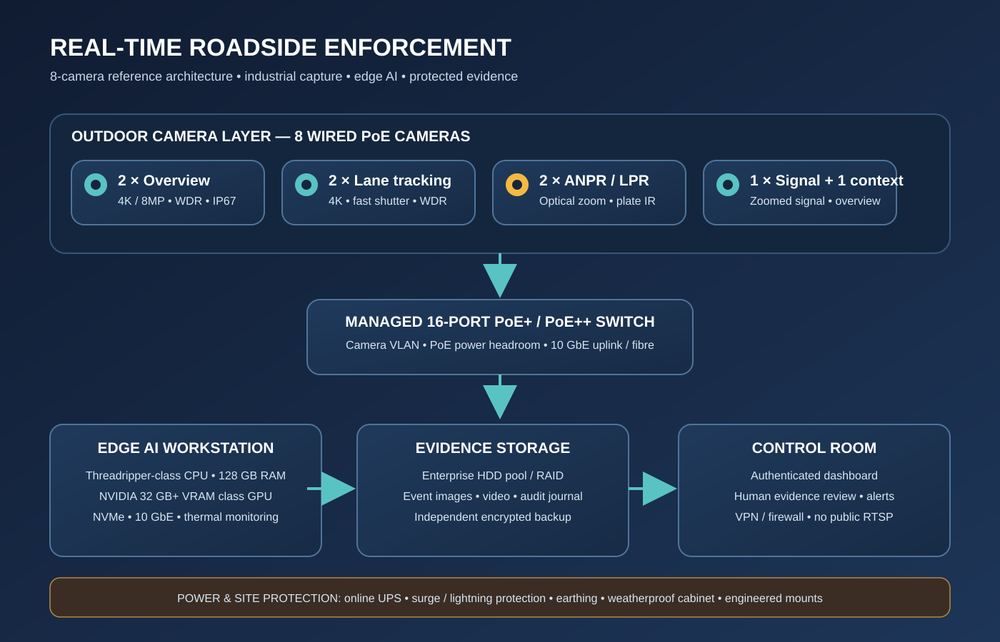

# Real-Time Roadside Deployment — Hardware Requirements

> **Design target:** a continuously operating, 8-camera roadside site with dedicated views for vehicle overview, lane behaviour, number-plate capture and traffic-signal state. This is a high-quality reference architecture, not a claim that the current software has already been validated for enforcement at this scale.

## 1. Important distinction: development PC vs. roadside deployment

A USB webcam opening successfully proves only that the capture path starts. It does not prove sustained multi-camera throughput, plate-reading accuracy, speed accuracy, night performance, weather resilience or evidentiary suitability.

For a dependable installation, procure industrial outdoor cameras, a dedicated inference workstation, managed PoE networking, protected power, independent recording/storage and proper mounting. Do not treat a consumer webcam, Wi-Fi camera or ordinary office PC as a roadside enforcement camera system.

## 2. Recommended 8-camera layout

| Quantity | Camera role | Required characteristics |
|---:|---|---|
| 2 | General road overview | 4K/8MP, 25–30 FPS, true WDR (preferably 120 dB class), motorized varifocal lens, IP67, IK10 where exposed, H.265, ONVIF Profile S/T |
| 2 | Lane / vehicle tracking | 4K/8MP, 25–30 FPS, low-light large sensor, fast shutter, motorized varifocal lens, precise fixed mounting |
| 2 | Dedicated ANPR / LPR | Purpose-built license-plate camera, 4MP or better, 1/1.8-inch-class or larger sensor where available, 50/60 FPS preferred, motorized optical zoom selected for measured distance, plate-focused IR, WDR, fast shutter and vendor-supported plate capture |
| 1 | Traffic-signal view | 4K/8MP, high dynamic range, optical zoom matched to signal distance, stable exposure and a clean view of signal heads |
| 1 | Secondary overview / context | 4K/8MP, WDR, outdoor-rated housing and lens suitable for the full scene |

**Camera selection rules**

- Prefer dedicated wired **PoE** cameras with a documented RTSP stream, ONVIF interoperability, configurable frame rate/bitrate, secure firmware support and local configuration access.
- Use optical zoom, not digital zoom, to frame distant plates and signal heads.
- For ANPR, choose lens focal length, mounting height, horizontal/vertical angle and capture distance from an on-site survey. A generic 2.8 mm wide-angle camera is usually the wrong choice for distant plates.
- Specify a fast shutter (often starting around 1/1000 s for moving plates, subject to light and speed), adequate IR illumination and day/night exposure profiles. Validate at the actual road speed and distance.
- Use separate ANPR views for each monitored direction/lane where possible. Avoid expecting one overview camera to provide reliable overview, plate OCR and signal-state evidence simultaneously.
- Demand sample footage from the exact camera/lens/IR combination at day, night, rain and the farthest required capture distance before bulk purchase.

## 3. Inference workstation — recommended high-performance tier

For 8 concurrent high-resolution streams with detection, tracking, OCR and behavioural analytics, use a dedicated workstation rather than the existing development PC.

| Part | Recommended specification |
|---|---|
| GPU | NVIDIA RTX 5090 32 GB class for a single-node high-throughput build; for validated multi-model or future expansion, consider a professional 48–96 GB VRAM workstation GPU after vendor and software compatibility review |
| CPU | AMD Threadripper / Threadripper PRO class, 24–32+ modern cores, or equivalent high-end workstation CPU; prioritize sustained multi-stream decode, preprocessing and concurrent services |
| RAM | 128 GB DDR5; ECC memory preferred on a workstation platform that supports it |
| OS / application storage | 2 TB high-end NVMe SSD for OS, code, models and active working data |
| Evidence / local recording | Separate enterprise/NAS-grade storage pool; do not use the OS drive as the only evidence store |
| Motherboard | Workstation board with adequate PCIe lanes, 10 GbE, multiple NVMe slots, remote management if available and supported memory capacity |
| PSU | High-quality 1200–1600 W ATX 3.1 unit (final rating must match the exact GPU/CPU vendor requirements); native GPU power connector, adequate transient headroom |
| Cooling / chassis | Full-tower workstation chassis, validated GPU clearance, high-airflow cooling and dust-filter maintenance plan |
| Network | 10 GbE workstation NIC; separate camera VLAN and management network |
| OS | Windows 11 Pro or a supported Linux distribution selected after validating the project's dependencies and deployment scripts |

**GPU note:** The RTX 5090 recommendation is a performance-class target, not a guarantee of 8-camera real-time performance. Actual throughput depends on model size, input resolution, inference cadence, decoder path, OCR frequency, tracking and analytics. Benchmark the exact workload with representative streams before purchase. Do not buy a GPU based only on advertised TOPS or gaming benchmarks.

**If the workstation is shared with other workloads**, or the site needs more cameras, higher model complexity or high availability, use a second inference node or a professional multi-GPU server rather than running every function on one overloaded PC.

## 4. PoE, networking and camera connectivity

- **Switch:** managed 16-port Gigabit PoE+ / PoE++ switch, with a documented total PoE budget sized from every camera's maximum draw plus at least 25–30% headroom. Select PoE+ or PoE++ per camera specification; do not assume every port can deliver its headline maximum simultaneously.
- **Uplinks:** 10 GbE uplink from the camera switching layer to the workstation/core switch where the topology and aggregate bitrate justify it. Use SFP+ fibre for long runs or electrically noisy outdoor routes.
- **Segmentation:** dedicated camera VLAN, separate management VLAN, firewall rules that deny camera-initiated internet access by default, and authenticated access to streams.
- **Cabling:** outdoor-rated UV-resistant Cat6/Cat6A, proper conduit, weatherproof junction boxes, labelled patching and tested terminations. Copper Ethernet channel length is normally limited to 100 m; use fibre and a suitable remote PoE switch for longer routes.
- **Router/firewall:** business/industrial firewall with VPN, access logging and no direct public exposure of camera RTSP ports.
- **Time:** reliable NTP time source for cameras, workstation, storage and dashboard. Verify clock drift during commissioning.

## 5. Storage and evidence retention

Use a dedicated NVR or NAS with enterprise surveillance/nearline drives, RAID appropriate to the required availability, hot-swap capability where practical, SMART monitoring and a separate backup target. RAID is not a backup.

Estimate continuous recording capacity with:

`Storage (TB) ≈ camera_count × average_Mbps × 0.0108 × retention_days`

This is an approximate decimal-TB estimate before filesystem/RAID overhead. Example: 8 cameras averaging 8 Mbps each for 30 days require about **20.7 TB raw**. Allow additional capacity for overhead, variable bitrate peaks, evidence exports and retention policy. Confirm actual camera bitrates with test recordings.

Recommended arrangement:
- NVMe: operating system, application, models and short-lived processing cache.
- RAID storage: continuous or event-based video, evidence images and audit data.
- Independent backup: encrypted copy of evidence and review/audit records, with scheduled restore tests.
- Define retention and deletion rules with the competent authority and applicable privacy requirements before recording live public roads.

## 6. Power, lightning and physical protection

| Item | Recommended specification |
|---|---|
| UPS | Online double-conversion UPS, typically 3 kVA class as a starting point for a workstation + network + storage rack; calculate actual watts, power factor and required runtime before final sizing |
| Runtime | Size battery capacity for the required graceful shutdown or generator transfer interval; do not assume a 3 kVA rating guarantees a particular runtime |
| Surge protection | Coordinated AC surge protection, Ethernet/PoE surge protection at exposed cable entry points, correct bonding and earthing designed by a qualified electrician |
| Enclosures | Lockable, ventilated, weather-rated cabinet with cable glands, thermal monitoring and service access |
| Mounting | Rigid engineered poles/brackets, vibration-resistant mounts, tamper-resistant fasteners and safe maintenance access |
| Environmental | Verify camera operating temperature, humidity, ingress and impact ratings against the actual site; plan dust, heat, monsoon and insect protection |

Outdoor camera poles, cabinets and power circuits must be installed and inspected by qualified professionals. Lightning protection and earthing must follow local electrical codes and site engineering.

## 7. Audio / honking capture

If honk monitoring is part of the deployment, use a weather-rated directional microphone or calibrated microphone array with wind protection and a suitable audio interface. Place and orient it only after a noise survey. A microphone mounted beside a road can capture overlapping vehicles, reflections and ambient noise; audio-only detection must not be treated as proof of which vehicle honked without validated source association.

## 8. Indicative procurement tiers

These are planning tiers, not live vendor quotations. Prices vary substantially by camera sensor/lens, ANPR capability, GPU availability, storage retention, installation distance and warranty.

| Build | Intended use | Indicative budget (INR) |
|---|---|---:|
| 1–2 camera engineering pilot | Prove capture, decode, detection and evidence workflow; not roadside enforcement | ₹3 lakh–₹6 lakh |
| 5–8 camera high-quality single-site build | Dedicated ANPR views, inference workstation, managed PoE, storage, UPS, poles and commissioning | ₹8 lakh–₹18 lakh+ |
| High-availability / professional server build | Redundant inference/storage/network, professional LPR optics, longer retention and site resilience | ₹18 lakh–₹35 lakh+ |

The previously discussed ₹2–5 lakh envelope is better treated as a constrained pilot budget, not a no-compromise 8-camera production budget with a high-end inference workstation, dedicated LPR optics, storage, UPS and professional installation. Get at least three itemized quotations and confirm warranty, firmware support, ONVIF/RTSP compatibility and replacement lead time.

## 9. Commissioning and acceptance — do not skip

Before calling the site real-time or production-ready:

1. Survey every camera position, lane, speed range, plate distance, signal position, lighting condition and cable route.
2. Obtain written permissions for camera placement, public-road recording, power, mounting and data retention from the competent authorities.
3. Bench-test every camera/lens/IR combination using real vehicles at the actual capture distance in day, night and rain.
4. Run all streams concurrently for at least 24–72 hours; record per-camera FPS, dropped frames, inference latency, queue age, GPU/CPU/RAM, storage throughput, thermal state and worker restarts.
5. Test camera/network/power disconnect and recovery, NTP drift, disk-full behaviour, backup restore and evidence reconciliation.
6. Measure ANPR exact-match accuracy by lane and condition; report false reads and unreadable plates separately.
7. Calibrate speed using surveyed road-plane geometry and an independent reference speed instrument. Record uncertainty and block speeding alerts when calibration is unverified.
8. Validate indicator and traffic-signal states against labelled, camera-disjoint footage. UNKNOWN must remain an allowed result.
9. Require an authorized human review process. Do not automatically issue fines or submit challans unless a legally approved authority integration exists.

## 10. Compatibility checklist before ordering

- [ ] Exact camera count, lane coverage, mounting positions and maximum cable lengths surveyed.
- [ ] ANPR lens and IR selected from target distance, plate pixel density and road speed.
- [ ] Workstation GPU, PSU, chassis, motherboard, cooling and power connector compatibility checked by part number.
- [ ] PoE switch total power budget checked against maximum simultaneous camera draw.
- [ ] Aggregate stream bitrate and 10 GbE uplink capacity calculated.
- [ ] Retention days, RAID usable capacity and independent backup capacity calculated.
- [ ] UPS runtime calculated from measured load.
- [ ] Vendor sample footage and replacement/warranty terms approved.
- [ ] Permissions, privacy, cybersecurity and retention approvals documented.
- [ ] Full workload benchmark and field acceptance criteria agreed before final payment.

## 11. What this repository currently proves — and does not prove

The codebase contains multi-camera capture/inference foundations, camera health signals, evidence logging/review, experimental ANPR and traffic-signal foundations, and calibration utilities. Those foundations do **not** mean the software has already been proven to process eight 4K streams at a guaranteed frame rate, read plates at a guaranteed accuracy, measure speed to legal metrology standards or operate unattended for 24/7 enforcement. The target workstation and camera specification must be validated against a representative site workload and labelled footage.

**Procurement recommendation:** finalize a site survey and camera sample-footage trial first, then select the exact lens and camera models; only after that lock the GPU/workstation, PoE budget and storage sizing. This avoids buying expensive equipment that cannot see the required plate or signal detail.
